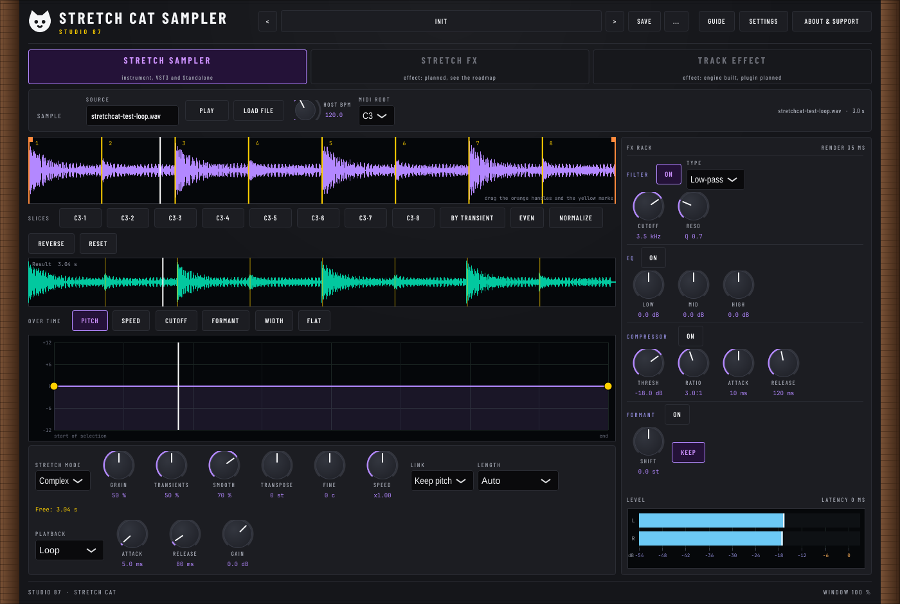

# Stretch Cat 🐈

Sampler with time stretch, for VST3 and standalone: change the speed without changing the pitch, or the pitch without changing the speed.

 Screenshot of the real plugin window (rendered offscreen in CI). The design is in docs/mockup.

**Manual:** [PDF, opens in the browser](https://github.com/SpeakingColors/stretch-cat-vst/blob/main/docs/stretch-cat-vst-manual.pdf)

## Status
Early test build (0.2). What exists today:
- A tested pure C++ engine (`src/core`): the stretch engine from the [mockup](docs/mockup/) (grains aligned by correlation, modes Beats, Tones, Texture, Re-Pitch, Complex, Formant+, speed, pitch and formant lanes over time), transient slicing, an 8 voice sampler with slices, a real formant shift, the filter / EQ / compressor rack, and the track effect engine (`TrackFx.h`: ring buffer, HOLD, grains).
- Rendering runs on a background thread and is swapped in lock free with a 20 ms crossfade. Changes that need a new render are not instant (see the manual).
- The JUCE plugin (`src/stretch`) with a real cat-ui window built from the mockup layout: wood cheeks, resizable at a fixed aspect, source and result waveforms, slice marks and pads, over-time lanes, FX rack, dB meter, presets, help on hover.
- Not in the plugin yet: the track effect build (engine and mockup page exist), the Detune and Output rack sections, Glide, BPM and key analysis. Nothing here has been tried by ear or in a real host yet. See [ROADMAP.md](ROADMAP.md).

Run the engine tests: `sh tests/run.sh` (needs only g++).

  

☕ Free and open source, made by one person. If it helps your music, a coffee on [Ko-fi](https://ko-fi.com/studio87) keeps it coming. 💜

## Docs
- [Interactive mockups](docs/README.md)
- [Roadmap](ROADMAP.md)

## License
AGPL-3.0-or-later, see [LICENSE](LICENSE).

Not affiliated with or endorsed by any hardware maker named here. All trademarks belong to their owners.
