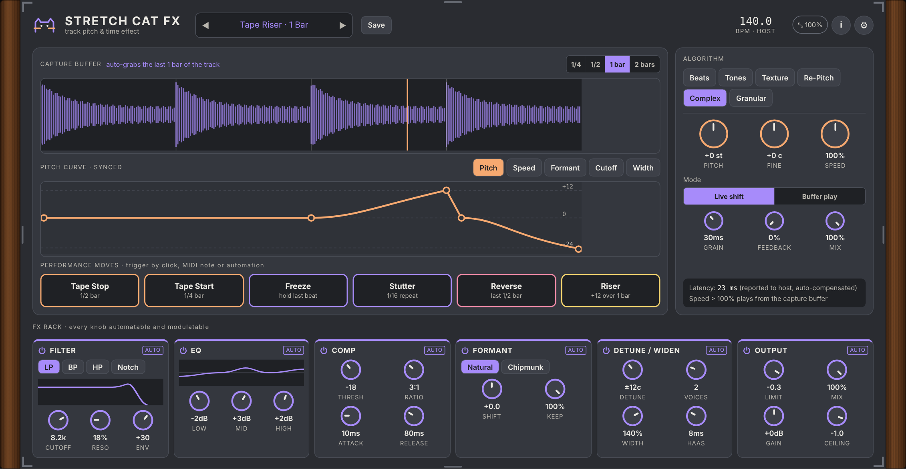

# Stretch Cat 🐈

Sampler with time stretch, for VST3 and standalone: change the speed without changing the pitch, or the pitch without changing the speed.

 Screenshot of the interactive mockup in docs/mockups.

**Manual:** [PDF, opens in the browser](https://github.com/SpeakingColors/stretch-cat-vst/blob/main/docs/stretch-cat-vst-manual.pdf)

## Status
Early. What exists today:
- A tested pure C++ engine (`src/core`): the stretch engine from the [mockup](docs/mockup/) (grains aligned by correlation, modes Beats, Tones, Texture, Re-Pitch, Complex, Formant+, speed and pitch lanes over time), transient slicing, and an 8 voice sampler (loop, one shot, gate, note repitch).
- A JUCE plugin shell (`src/stretch`): load a sound, the stretched version is rendered when a control changes, MIDI notes play it. JUCE's generic editor plus a Load button.
- Not yet: the cat-ui editor, lanes and slices in the plugin, the track effect version (stretching the DAW audio live), the Formant control (the mode exists, the shift does not), the filter/EQ/compressor rack, presets. The render runs on the message thread for now. Nothing here has been tried by ear in a host yet.

Run the engine tests: `sh tests/run.sh` (needs only g++).

  

☕ Free and open source, made by one person. If it helps your music, a coffee on [Ko-fi](https://ko-fi.com/studio87) keeps it coming. 💜

## Docs
- [Interactive mockups](docs/README.md)
- [Roadmap](ROADMAP.md)

## License
AGPL-3.0-or-later, see [LICENSE](LICENSE).

Not affiliated with or endorsed by any hardware maker named here. All trademarks belong to their owners.
